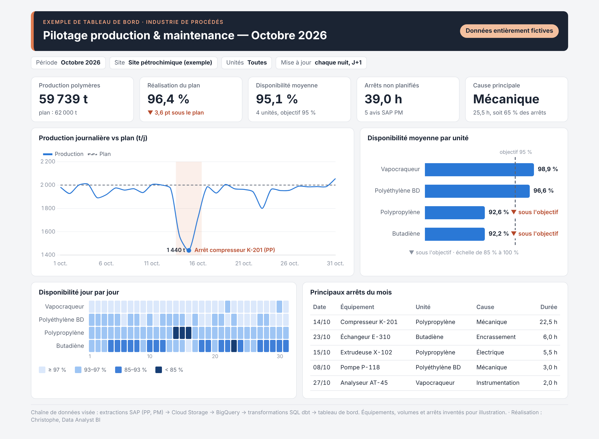
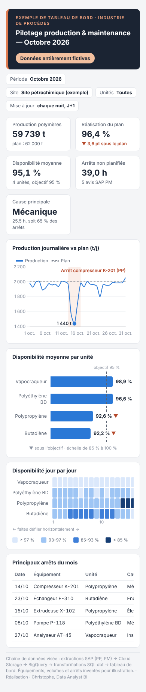

# Pilotage production & maintenance — tableau de bord

Prototype de démonstration pour un site pétrochimique : un vapocraqueur, une unité de butadiène
et deux unités de polymères. Il montre en un coup d'œil **si la production suit le plan** et
**où se perdent les heures de disponibilité**. Aujourd'hui, l'exploitation suit ces chiffres dans
des exports SAP retravaillés sous Excel ; ce tableau de bord les calcule automatiquement.

> **Données entièrement fictives.** Équipements, volumes et arrêts sont inventés pour
> l'illustration. Aucun nom de client, aucune donnée réelle.

**Voir le tableau de bord en ligne :** https://cak91dy.github.io/dashboard-production/



<details>
<summary>Version téléphone</summary>


</details>

## Ce que l'on lit en moins d'une minute (octobre 2026)

| | Résultat | Lecture |
|---|---|---|
| Production polymères | **59 739 t** pour un plan de 62 000 t | 96,4 % du plan, soit 3,6 points sous l'objectif |
| Jour le plus bas | **1 440 t le 15 octobre** | arrêt du compresseur K-201 (polypropylène), du 14 au 16 octobre |
| Disponibilité moyenne | **95,1 %** pour un objectif de 95 % | objectif tenu de justesse : le polypropylène (92,6 %) et le butadiène (92,2 %) sont dessous |
| Arrêts non planifiés | **39,0 h**, 5 avis SAP PM | la mécanique représente 25,5 h, soit 65 % des heures |

## Définition des indicateurs

Tous les chiffres sont **calculés depuis les CSV** de `data/` au chargement de la page. Aucun
résultat n'est écrit en dur dans le code.

| Indicateur | Définition | Source |
|---|---|---|
| Production polymères | Somme de la production journalière des unités PEBD et PP, en tonnes | `production_journaliere.csv` |
| Réalisation du plan | Production ÷ plan. L'écart en points est (réalisation − 100 %), calculé **avant** arrondi | idem |
| Jour le plus bas | Jour de production minimale. La **zone colorée** couvre les jours consécutifs autour de ce minimum sous 90 % du plan | idem et `arrets.csv` |
| Disponibilité d'une unité | Moyenne des disponibilités journalières (temps de marche ÷ temps calendaire) | `disponibilite_unites.csv` |
| Disponibilité moyenne | **Moyenne simple des 4 unités** : chaque unité pèse autant, quelle que soit sa taille | idem |
| Arrêts non planifiés | Somme des durées des avis SAP PM du mois, et nombre d'avis | `arrets.csv` |
| Cause principale | Cause qui cumule le plus d'heures d'arrêt, et sa part du total | idem |
| Carte de chaleur | Disponibilité de chaque unité, jour par jour, en 4 classes : ≥ 97 %, 93–97 %, 85–93 %, < 85 % (plus foncé = moins disponible) | idem |

Le seul paramètre fixé dans le code est l'objectif de disponibilité de 95 %, qui est une cible
métier et non un résultat.

## Architecture visée en production

```
SAP PP (production, plan) ─┐
                           ├─► Cloud Storage ─► BigQuery ─► dbt (SQL : staging → marts) ─► tableau de bord
SAP PM (avis d'arrêt)  ────┘     (extractions       (entrepôt)   (règles de calcul           (Power BI ou web)
                                  nocturnes)                      testées)
```

- **Extractions nocturnes** depuis SAP, pour une mise à jour chaque nuit à J+1.
- **dbt** porte les règles de calcul (disponibilité, rattachement des avis aux unités) en SQL
  versionné et testé. Ce sont les mêmes règles que `scripts/verifier.py`.
- Le prototype remplace cette chaîne par des CSV, pour être consultable sans infrastructure.

## Contenu du dépôt

```
docs/                     page web publiée par GitHub Pages (HTML + CSS + JS, Chart.js 4.4.1)
  data/                   copie exacte de data/, lue par la page
data/                     CSV de référence d'octobre 2026 (à ne pas modifier)
scripts/
  donnees_fictives.py     génère les CSV de référence (graine fixe 42)
  exporter_csv.py         réécrit data/ à l'identique
  verifier.py             recalcule les chiffres de référence et les compare (28 contrôles)
  generer_donnees_powerbi.py   jeu détaillé de 105 120 lignes pour Power BI
  graphiques.py           graphiques PNG pour les supports de présentation
powerbi/                  version Power BI : données, mesures DAX, thème, guide de montage
graphiques/               graphiques PNG, capture et PDF du tableau de bord
maquette_reference.png    maquette validée
```

## Lancer en local

```bash
cd docs
python -m http.server 8000
```

Ouvrir ensuite http://localhost:8000. Un double-clic sur `index.html` ne fonctionne pas : le
navigateur bloque la lecture des CSV hors serveur.

Vérifier les chiffres (Python 3.10+, `pip install pandas`) :

```bash
python scripts/verifier.py
```

Le script renvoie le code 1 si un chiffre ne correspond plus à la référence.

## Version Power BI

Le dossier `powerbi/` permet de reconstruire le même tableau de bord dans Power BI Desktop, à
partir d'un modèle en étoile plus fin.

- **Données** : 105 120 lignes horaires (24 mois × 24 h × 6 lignes de production), le plan
  journalier, 178 avis SAP PM et 4 dimensions. Les agrégats d'octobre 2026 retombent
  **exactement** sur les CSV de référence, ce que contrôle `verifier.py`.
- **Mesures** : environ 50 mesures DAX dans `powerbi/mesures.dax`, collées en une fois dans la
  vue Requête DAX, avec une requête de contrôle.
- **Montage** : pas à pas dans [`powerbi/GUIDE_POWER_BI.md`](powerbi/GUIDE_POWER_BI.md).
- **Analyses en plus** : tendances sur 24 mois, Pareto des causes, MTTR, MTBF, comparaison à
  l'année précédente.

## Limites

- **Heures d'arrêt et disponibilité ne se recoupent pas exactement.** La durée d'un avis SAP PM
  mesure l'indisponibilité de l'*équipement*. Si celui-ci est doublé (pompe de secours,
  analyseur), la ligne continue de tourner. Exemple : l'analyseur AT-45 compte 2 h d'arrêt le
  27 octobre, alors que le vapocraqueur est à 100 % ce jour-là.
- **Moyenne simple ou pondérée ?** La disponibilité moyenne donne le même poids à chaque unité.
  Pondérée par le nombre de lignes de production, elle tomberait à 94,9 %. Le choix est à valider
  avec l'exploitation.
- **Un seul mois, sans filtres actifs.** La page web montre octobre 2026 ; les pastilles
  « Période » et « Unités » sont informatives. La version Power BI ajoute de vrais filtres et
  l'historique sur 24 mois (simulé).
- **Prototype.** Pas d'authentification ni d'extraction SAP réelle. Chart.js est chargé depuis un
  CDN (jsDelivr), donc une connexion internet est nécessaire.

---

Réalisation : Christophe, Data Analyst BI — Python, SQL, Power BI, DAX.
